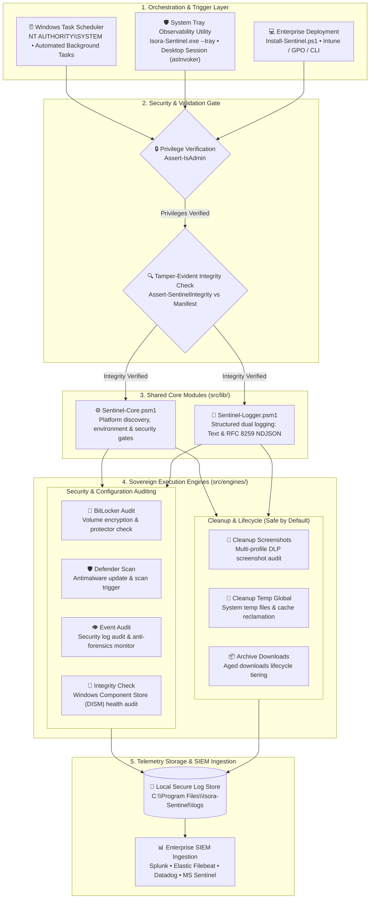

<p align="center">
  
</p>

<h1 align="center">Isora Sentinel Suite</h1>

<p align="center">
  <strong>Endpoint Auditing, Cleanup, and Compliance Telemetry for Microsoft Windows</strong><br>
  Controls mapped to ISO/IEC 27001:2022, ISO/IEC 20000-1:2018, SOC 2 Type II, and CIS Benchmarks
</p>

<p align="center">
  <a href="CHANGELOG.md"></a>
  <a href="LICENSE"></a>
  <a href="installer/BUILD_PROVENANCE.json"></a>
  <a href="docs/ISO_MAPPING.md"></a>
  <a href="tests/"></a>
  
  
</p>

---

## 1. Executive Summary & Operational Scope

**Isora Sentinel** is an enterprise-grade, sovereign host-based governance and security automation suite for Microsoft Windows fleets, developed by **Isora Cloud Group**. Engineered for corporate IT governance, SecOps teams, and regulated industries (Financial Services, Healthcare, Critical Infrastructure, and Cloud Enterprises), it provides continuous compliance verification, disk capacity reclamation, sensitive visual data sanitization (DLP), and structured SIEM telemetry without the memory overhead, licensing lock-in, or supply-chain attack surface of traditional third-party agents.

### Why Large Corporations Choose Isora Sentinel

| Enterprise Evaluation Criterion | Traditional Endpoint RMM / Compliance Agents | Isora Sentinel Suite (v2.5.3) |
| :--- | :--- | :--- |
| **Deployment Footprint** | `150 MB – 500 MB` installer + third-party runtimes | **`< 600 KB` single self-contained signed binary** |
| **Idle RAM / CPU Overhead** | `150 MB – 400 MB` continuous background daemon | **`0 MB` idle daemon overhead** (delegates to native Windows Kernel Task Scheduler `NT AUTHORITY\SYSTEM`) |
| **Supply-Chain Attack Surface** | Hundreds of external npm/Python/NuGet dependencies | **Zero external dependencies** (100% native Windows BCL `.NET 4.8` & PowerShell 5.1+) |
| **Network & Data Sovereignty** | Mandatory cloud heartbeats & vendor SaaS telemetry | **100% Air-Gapped & Sovereign** (zero outbound sockets, zero cloud telemetry) |
| **CAB & SecOps Auditability** | Opaque compiled binaries | **Built-in `--audit` & `--extract` CLI switches** + `BUILD_PROVENANCE.json` + SHA-256 manifest |
| **Enterprise Fleet Rollout** | Complex proprietary server infrastructure | **Turnkey Intune Win32 / SCCM / GPO silent deployment** + SIEM NDJSON forwarding |

Designed to assist organizations subject to regulatory frameworks such as **ISO/IEC 27001**, **ISO/IEC 20000-1**, **SOC 2 Type II**, and **CIS Microsoft Windows Benchmarks**, Isora Sentinel executes maintenance and audit routines using native Windows APIs, PowerShell, and .NET Framework. All telemetry is emitted as standardized, structured logs (RFC 8259 NDJSON or plain text) compatible with central Security Information and Event Management (SIEM) collectors.

> **Note on Compliance:** Isora Sentinel supports evidence collection and control verification, but does not certify compliance with any standard and does not replace an audit.

### Core Engineering Requirements
* **Zero External Dependencies:** Built solely on native Windows components (`powershell.exe`, `schtasks.exe`, `dism.exe`, `manage-bde.exe`, `MpCmdRun.exe`). Requires no package managers (NuGet, Chocolatey) or third-party interpreters (Python, Node.js).
* **Safe-by-Default Operation:** Destructive engines (file deletion or relocation) run in audit-only mode by default and require an explicit `-Apply` switch to perform modifications.
* **Deterministic Hub-and-Spoke Architecture:** Isolates common utilities (tamper-evident integrity checks, standardized logging, privilege verification) in `src/lib/`, while operational engines execute as independent routines in `src/engines/`.
* **Privilege Separation:** Distinguishes between local user profile operations and machine-wide administrative routines executed under `NT AUTHORITY\SYSTEM`.
* **Tamper-Evident Integrity Check:** Core modules and execution scripts are checked against SHA-256 fingerprints recorded in `integrity.manifest.json`.

---

## 2. Control Mapping & Regulatory Traceability

Isora Sentinel provides automated telemetry and verification mapped to controls defined in international standards:

| Control Standard | Clause / ID | Domain | Technical Implementation in Isora Sentinel |
| :--- | :--- | :--- | :--- |
| **ISO/IEC 27001:2022** | **A.8.1** | User Endpoint Devices | Discovers standard, redirected, and cloud-synced screenshot folders across all user profiles; audits visual artifacts to support Data Loss Prevention (DLP). Purges only when `-Apply` is explicitly passed. |
| **ISO/IEC 27001:2022** | **A.8.7** | Protection Against Malware | Resolves active Microsoft Defender platform binaries dynamically, updates signatures, and dispatches scans with exit code capture. |
| **ISO/IEC 27001:2022** | **A.8.10** | Information Deletion | Supports systematic data sanitization on temporary storage, diagnostic crash dumps, and staged installation caches. Requires `-Apply` to delete files. |
| **ISO/IEC 27001:2022** | **A.8.15** | Logging | Produces microsecond-precision NDJSON records; audits Windows Event Logs for clearing events (1102, 104) and brute-force bursts (4625). |
| **ISO/IEC 27001:2022** | **A.8.20** | Systems Security | Dispatches DISM online component store health checks to detect binary drift or corruption in operating system libraries. |
| **ISO/IEC 27001:2022** | **A.8.24** | Use of Cryptography | Audits BitLocker volume encryption state, protection status, and key protectors across OS and fixed data volumes without altering state. |
| **ISO/IEC 20000-1:2018** | **§8.2** | Capacity Management | Evaluates Windows Update caches, WER queues, and multi-user temporary directories to reclaim storage capacity. Requires `-Apply` to delete files. |
| **SOC 2 Type II** | **CC6.1 / CC6.7 / CC7.1** | Security & Availability | Supports evidence collection for administrative access gates, data sanitization at rest, and continuous event log auditing. |
| **CIS Windows Benchmark** | **Controls 3.11, 8.2, 10.1** | Endpoint configuration auditing | Helps verify disk encryption, event log retention monitoring, and Defender scanning schedules. |

Detailed audit evidence commands and control rationales are provided in **[docs/ISO_MAPPING.md](docs/ISO_MAPPING.md)**.

---

## 3. Architecture & Security Model



### Security Controls & Privilege Enforcement
1. **Local Privilege Escalation (LPE) Defense:**  
   The installation directory (`C:\Program Files\Isora-Sentinel\`) is secured with explicit Windows Access Control Lists (ACLs). Inherited user write permissions are stripped; `BUILTIN\Users` retains read and execute permissions (`RX`) only.
2. **Tamper-Evident Integrity Check:**  
   The function `Assert-SentinelIntegrity` checks operational scripts and modules against `integrity.manifest.json`. Under `NT AUTHORITY\SYSTEM` or production paths, missing or mismatched files result in immediate execution termination (Fail-Closed).  
   > **Limitation Note:** The manifest file is not cryptographically signed. Therefore, a user with administrative rights can alter both files and the manifest. This check is designed to detect accidental file corruption or unsophisticated modification only.
3. **Automated Log Retention:**  
   The logging subsystem implements configurable file pruning (`Clear-OldSentinelLogs`, default 90-day retention) to prevent local drive exhaustion while preserving execution history.

---

## 4. Execution Engines Reference

All engines reside in `src/engines/` and accept structured command-line parameters. Destructive engines run in audit-only mode by default:

| Engine | Primary Parameters | Default Behavior | Artifacts Emitted |
| :--- | :--- | :--- | :--- |
| `Invoke-CleanupScreenshots.ps1` | `-Apply` `[switch]`<br>`-AuditOnly` `[switch]` | Scans all user profiles via `ProfileList` and user registry hives. **Default: Audit-only** (identifies screenshots without deleting). Pass `-Apply` to purge local screenshots. Skips cloud placeholders (`ReparsePoint` / `Offline`). | `ProfileCount`, `Path`, `TotalIdentified`, `TotalPurged` |
| `Invoke-CleanupTempGlobal.ps1` | `-Apply` `[switch]`<br>`-AuditOnly` `[switch]`<br>`-DaysOld [int]` | Evaluates `C:\Windows\Temp`, `SoftwareDistribution\Download`, WER crash queues, and user `%TEMP%` caches. **Default: Audit-only** (reports reclaimable space without deleting). Pass `-Apply` to delete files older than threshold. | `Path`, `TotalIdentified`, `TotalCleaned`, `ReclaimedBytes` |
| `Invoke-DefenderScan.ps1` | `-ScanType [1\|2]`<br>`-SkipSignatureUpdate` | Refreshes malware definitions, then triggers Quick (`1`) or Full (`2`) scan via `MpCmdRun.exe`. Exit code 2 triggers active threat alerts. | `EnginePath`, `ScanType`, `SignatureUpdateCode`, `ExitCode` |
| `Invoke-IntegrityCheck.ps1` | `-AutoRepair`<br>`-QuickCheck` | Audits the Windows Component Store via `dism.exe /ScanHealth` (or `/CheckHealth` with `-QuickCheck`). Dispatches `/RestoreHealth` when repairable corruption is found and `-AutoRepair` is passed. | `DismPath`, `DismCode`, `HealthStatus`, `AutoRepair` |
| `Invoke-BitLockerAudit.ps1` | `-TargetMountPoint`<br>`-IncludeRemovable` | Evaluates BitLocker encryption percentage, protection state, and protector types across OS and fixed volumes without altering state. Removable media is excluded by default. | `MountPoint`, `VolumeType`, `ProtectionStatus`, `VolumeStatus`, `KeyProtectors` |
| `Invoke-EventAudit.ps1` | `-Hours [int]`<br>`-FailedLogonThreshold [int]` | Audits `Security.evtx` for Event 1102 (Log cleared) and Event 4625 (Failed logon bursts), and `System.evtx` for Event 104 (Log cleared). Resolves SIDs to account names. | `WindowHours`, `AnomaliesDetected`, `EventID`, `User`, `Timestamp` |
| `Invoke-ArchiveDownloads.ps1` | `-Apply` `[switch]`<br>`-AuditOnly` `[switch]`<br>`-DaysOld [int]`<br>`-CustomArchiveDir [string]` | Identifies unmanaged downloads older than threshold (default 30 days). **Default: Audit-only** (reports files without moving). Pass `-Apply` to relocate them to a protected archive (`Documents\Isora_Sentinel_Archived\Downloads`) with a user policy notice file. | `User`, `MovedCount`, `ReclaimedBytes`, `ArchiveDir` |

---

## 5. Deployment & Configuration

### Option A: Standalone GUI Installer (`Isora-Sentinel-Setup.exe`)
For manual deployments, staging evaluation, or workstation rollouts:
1. Run `installer/Isora-Sentinel-Setup.exe` with Administrator privileges.
2. The four-step wizard guides configuration of target paths, scheduled task frequencies, cleanup modes (Audit-Only by default vs. Apply), integrity verification, and optional desktop tray monitor installation.
3. Modules are unpacked from an internal package resource and verified against SHA-256 hashes prior to task scheduling.

### Option B: Unattended Deployment (`Install-Sentinel.ps1`)
For mass rollouts via Microsoft Intune, Microsoft Endpoint Configuration Manager (SCCM), Active Directory Group Policy (GPO), or RMM agents:

```powershell
powershell.exe -NoProfile -ExecutionPolicy Bypass -File .\installer\Install-Sentinel.ps1 `
    -Silent `
    -InstallDir "C:\Program Files\Isora-Sentinel" `
    -ScheduleScreenshots "Daily" `
    -ScheduleTemp "Daily" `
    -ScheduleDefender "Weekly" `
    -ScheduleIntegrity "Weekly" `
    -ScheduleBitLocker "Daily" `
    -ScheduleEventAudit "Daily" `
    -ScheduleDownloads "Monthly"
```

#### Supported Deployment Parameters:
* `-InstallDir` `[string]`: Target installation folder (default: `C:\Program Files\Isora-Sentinel`).
* `-LogsDir` `[string]`: Custom log storage path (default: `C:\Program Files\Isora-Sentinel\logs`).
* `-Silent` `[switch]`: Suppresses console prompts for non-interactive execution.
* `-SkipIntegrityCheck` `[switch]`: Bypasses pre-installation manifest check (recovery only).
* `-Schedule*` `[string]`: Sets trigger frequency (`Daily`, `Weekly`, `Monthly`) per engine.
* `-ApplyScreenshots` `[switch]`: Configures screenshot scheduled task to execute with `-Apply` (default: audit-only).
* `-ApplyTemp` `[switch]`: Configures temporary file cleanup task to execute with `-Apply` (default: audit-only).
* `-ApplyDownloads` `[switch]`: Configures download archival task to execute with `-Apply` (default: audit-only).

### Option C: System Tray Monitor (`Isora-Sentinel.exe --tray`)
The system tray monitor runs within user desktop sessions:
* Real-time SHA-256 integrity badge (Green = Verified; Amber = Discrepancy detected).
* On-demand manual execution with standard Windows UAC elevation.
* Direct configuration panel (`TaskConfigForm.cs`) to adjust Task Scheduler schedules.

---

## 6. Structured Telemetry & SIEM Forwarding

### Machine-Wide NDJSON Activation
To instruct all engines to emit JSON formatted for SIEM ingestion, configure the system-level environment variable:

```powershell
[System.Environment]::SetEnvironmentVariable("SENTINEL_LOG_FORMAT", "JSON", "Machine")
```

### Standardized Event Schema (RFC 8259)
Every log line is emitted in UTF-8 without Byte Order Mark (BOM):

```json
{
  "Timestamp": "2026-10-28 02:15:30.1284591",
  "Level": "SUCCESS",
  "Host": "SRV-LON-APP01",
  "Identity": "NT AUTHORITY\\SYSTEM",
  "PID": 14208,
  "Message": "VOLUME COMPLIANT: C: is fully encrypted with active protection.",
  "Metadata": {
    "MountPoint": "C:",
    "VolumeType": "OperatingSystem",
    "ProtectionStatus": "On",
    "VolumeStatus": "FullyEncrypted",
    "EncryptionPct": "100",
    "KeyProtectors": "Tpm;RecoveryPassword"
  }
}
```

Pre-configured shipper definitions for **Splunk Universal Forwarder**, **Elastic Filebeat**, **Datadog Agent**, and **Microsoft Sentinel** are documented in **[docs/SIEM_INTEGRATION.md](docs/SIEM_INTEGRATION.md)**.

---

## 7. Quality Assurance & Package Verification

The codebase includes an automated test harness built on Pester and AST static analysis:

```powershell
# Run the test suite:
powershell.exe -ExecutionPolicy Bypass -File .\tests\Invoke-Tests.ps1
```

```
Test Summary: Passed=41, Failed=0, Total=41
- Sentinel-Core.Tests.ps1    : Privilege assertion, Defender discovery, integrity gate
- Sentinel-Engines.Tests.ps1 : Parameter binding, switch verification (-Apply, -AuditOnly)
- Sentinel-Logger.Tests.ps1  : Text/NDJSON serialization, RFC 8259 escaping, live progress tracking
- Sentinel-Syntax.Tests.ps1  : PowerShell Abstract Syntax Tree (AST) validation
```

### Multi-Vendor Antivirus Scan Status (VirusTotal)

The compiled standalone installer (`Isora-Sentinel-Setup.exe`) is submitted to VirusTotal for analysis across security engines:

* **Build Provenance Receipt:** [`installer/BUILD_PROVENANCE.json`](installer/BUILD_PROVENANCE.json) (deterministic compiler flags, bundled module SHA-256 table, and certificate thumbprint).
* **Static & Dynamic Audit:** Zero outbound network sockets, zero unmanaged third-party DLLs, and 100% inspectable payload via `--audit` and `--extract`.
* **Analyzed Binary:** `Isora-Sentinel-Setup.exe` (v2.5.3)
* **SHA-256 Digest:** `63FDDACB960CC3CE8741B3DC07512160F4F8A30E39BFC634E8177EC430FC47B1`
* **Code Signing Verification:** Authenticode SHA-256 signature issued to `CN=Sandra Gabriela Puerto Torres (Isora Cloud Group)` with DigiCert timestamp responder (`CN=DigiCert SHA256 RSA4096 Timestamp Responder 2026 1`).

> **Important Note:** A clean antivirus scan reflects a single point in time and does not prove that the software is completely safe or free of vulnerabilities; it is not a substitute for reviewing the source code.

### Package Inspection & Transparent Auditing
System administrators and security teams can verify the integrity of the compiled distribution without executing the installer wizard:

```powershell
# 1. Non-interactive in-memory SHA-256 integrity check against manifest (exits 0 if valid):
.\installer\Isora-Sentinel-Setup.exe --audit

# 2. Extract embedded package files to a sandbox directory for static code review:
.\installer\Isora-Sentinel-Setup.exe --extract C:\Sandbox\SentinelAudit

# 3. Automated offline inspector harness:
powershell.exe -ExecutionPolicy Bypass -File .\installer\Verify-PackageIntegrity.ps1
```

This utility extracts PE metadata, unpacks embedded resources in memory, and re-hashes every script against `integrity.manifest.json`.

---

## 8. Authorship, Sole Architecture & AI Code Generation Disclosure

* **Sole System Architect, Security Designer & Technical Direction:** **Sandra Gabriela Puerto Torres** ([sandrapuerto.com](https://sandrapuerto.com) · [LinkedIn](https://www.linkedin.com/in/sandra-puerto/) · [GitHub: @sandra-puerto](https://github.com/sandra-puerto)) is the **sole architect** (*única arquitecta*) of Isora Sentinel Suite, responsible for the system architecture, security threat modeling, UAC/privilege separation boundaries, ISO/IEC 27001 & 20000-1 regulatory control mapping, and quality assurance verification.
* **Code Generation & Implementation Engine:** **Google Antigravity** — All source code generation, modular refactoring, and automated test implementation are carried out by **Google Antigravity** under the direct architectural specification, engineering governance, and human review of **Sandra Gabriela Puerto Torres**.
* **Commercial Brand & Distribution:** Isora Cloud Group ([isora.com.co](https://isora.com.co))

---

## 9. Repository Structure

```
Isora Sentinel/
├── .github/
│   └── workflows/
│       └── test.yml                  # GitHub Actions CI validation workflow
├── docs/
│   ├── ARCHITECTURE.md               # System design specification & security boundaries
│   ├── ISO_MAPPING.md                # ISO/IEC 27001 & 20000-1 control traceability
│   ├── OPERATOR_GUIDE.md             # Operations and parameter manual
│   ├── SIEM_INTEGRATION.md           # Forwarder configs (Splunk, Elastic, Datadog)
│   └── TROUBLESHOOTING.md            # Error codes, return values, and remediations
├── installer/
│   ├── src/
│   │   ├── AssemblyInfo.cs           # Assembly metadata and versioning
│   │   ├── app.ico                   # Application icon asset
│   │   ├── app.manifest              # Windows UAC application manifest (requireAdministrator)
│   │   ├── app.svg                   # Vector icon asset
│   │   ├── SentinelCore.cs           # Shared .NET 4.8 BCL core: catalog, security ACLs, UAC & process runner
│   │   ├── SentinelSetup.cs          # Standalone WinForms installer wizard
│   │   ├── SentinelTray.cs           # System tray observability process
│   │   ├── TaskConfigForm.cs         # Task Scheduler GUI configurator
│   │   └── UninstallForm.cs          # Interactive WinForms uninstallation wizard
│   ├── Build-InstallerExe.ps1        # MSIL csc.exe native builder
│   ├── Build-IntegrityManifest.ps1   # SHA-256 integrity manifest generator
│   ├── Install-Sentinel.ps1          # Unattended CLI installation script
│   ├── Uninstall-Sentinel.ps1        # Removal and task unregistration script
│   └── Verify-PackageIntegrity.ps1   # Package binary inspection script
├── src/
│   ├── engines/
│   │   ├── Invoke-ArchiveDownloads.ps1   # Aged downloads lifecycle & tiering engine
│   │   ├── Invoke-BitLockerAudit.ps1     # BitLocker encryption compliance audit
│   │   ├── Invoke-CleanupScreenshots.ps1 # DLP screenshot sanitization engine
│   │   ├── Invoke-CleanupTempGlobal.ps1  # System & user cache capacity reclamation
│   │   ├── Invoke-DefenderScan.ps1       # Microsoft Defender scan & update engine
│   │   ├── Invoke-EventAudit.ps1         # Windows Security & System event log audit
│   │   └── Invoke-IntegrityCheck.ps1     # DISM component store integrity audit
│   └── lib/
│       ├── Sentinel-Core.psm1        # Elevation check, Defender path, integrity check
│       └── Sentinel-Logger.psm1      # Standardized logging & retention module
├── tests/
│   ├── Invoke-Tests.ps1              # Unified Pester test runner
│   ├── Sentinel-Core.Tests.ps1       # Core module unit tests
│   ├── Sentinel-Engines.Tests.ps1    # Engine parameter & signature tests
│   ├── Sentinel-Logger.Tests.ps1     # Logging & serialization tests
│   └── Sentinel-Syntax.Tests.ps1     # AST static syntax parser tests
├── CHANGELOG.md                      # Version release notes
├── CODE_OF_CONDUCT.md                # Community and contributor guidelines
├── CONTRIBUTING.md                   # Development workflow and PR instructions
├── integrity.manifest.json           # SHA-256 cryptographic file table
├── LICENSE                           # Apache License 2.0
├── NOTICE                            # Project notice and attribution
├── README.md                         # Main repository documentation
├── ROADMAP.md                        # Product roadmap & future .NET 8/9 LTS branch strategy
└── SECURITY.md                       # Vulnerability disclosure policy
```

---

## 10. Security Policy & Responsible Disclosure

Security vulnerabilities, privilege escalation concerns, or cryptographic discrepancies should be reported privately in accordance with **[SECURITY.md](SECURITY.md)**:

* **Security Operations:** [security@isora.com.co](mailto:security@isora.com.co)
* **General Contact:** [contact@isora.com.co](mailto:contact@isora.com.co)
* **Response Commitment:** Initial receipt acknowledgment within 48 business hours; patch coordination in isolated staging prior to public release. Safe harbor terms protect good-faith security research.

---

## 11. Intellectual Property & License

* **Commercial Brand & Distribution:** Isora Cloud Group ([isora.com.co](https://isora.com.co))
* **Sole Architect & Copyright Holder:** Sandra Gabriela Puerto Torres ([sandrapuerto.com](https://sandrapuerto.com) · [LinkedIn](https://www.linkedin.com/in/sandra-puerto/))
* **Code Generation Engine:** Google Antigravity (under the sole architectural direction of Sandra Gabriela Puerto Torres)
* **License:** Distributed under the terms of the **[Apache License, Version 2.0](LICENSE)** starting from version 2.4.0. Prior versions (v2.3.1 and earlier) were released under the MIT License and remain under MIT. See [NOTICE](NOTICE) for project attribution.
