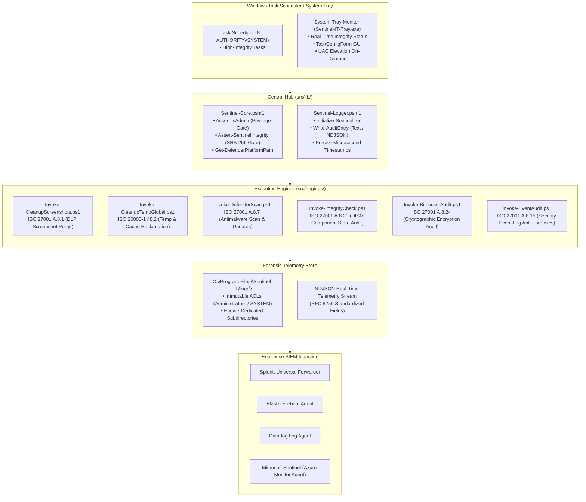
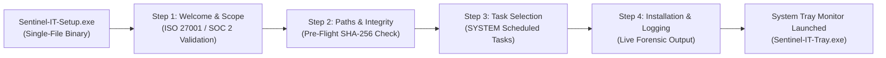

<div align="center">

# 🛡️ Sentinel-IT Suite
### Sovereign Endpoint Hygiene & Compliance Automation for Windows
**ISO/IEC 27001:2022 · ISO/IEC 20000-1:2018 · SOC 2 Type II · CIS Benchmark**

[](https://www.linkedin.com/in/sandra-puerto/)
[](https://isora.com.co)
[](https://github.com/sandra-puerto)
[](https://www.linkedin.com/in/sandra-puerto/)
[](CHANGELOG.md)
[](#)
[](#)
[](docs/ISO_MAPPING.md)
[](tests/)
[](LICENSE)

*Sovereign endpoint hygiene, security telemetry, and regulatory compliance platform engineered for enterprise Microsoft Windows fleets without external dependencies or heavy background agents.*

---
</div>

## 📚 1. Documentation Index

Comprehensive guides for security architects, system administrators, auditors, and SOC engineers:

| Document | Scope & Technical Content |
| :--- | :--- |
| **[docs/OPERATOR_GUIDE.md](docs/OPERATOR_GUIDE.md)** | **Enterprise Operator & Deployment Manual:** Step-by-step GUI wizard instructions, interactive CLI, GPO/Intune mass deployment, parameter reference (`-AuditOnly`, `-ScanType`, `-AutoRepair`), and scheduled task management. |
| **[docs/ARCHITECTURE.md](docs/ARCHITECTURE.md)** | **System Architecture Specification:** Hub-and-Spoke topology, security boundaries, cryptographic integrity gating, UAC elevation architecture, and execution lifecycles. |
| **[docs/ISO_MAPPING.md](docs/ISO_MAPPING.md)** | **Regulatory Compliance & Audit Evidence Matrix:** Clause-by-clause mapping to ISO/IEC 27001:2022, ISO/IEC 20000-1:2018, SOC 2 Type II, CIS Windows Benchmarks, and auditor verification commands. |
| **[docs/SIEM_INTEGRATION.md](docs/SIEM_INTEGRATION.md)** | **Enterprise SIEM Ingestion Guide:** Splunk Universal Forwarder configuration, Elastic Filebeat pipeline, Datadog Agent, Azure Sentinel (KQL/SPL alert queries, dashboards, and detection rules). |
| **[docs/TROUBLESHOOTING.md](docs/TROUBLESHOOTING.md)** | **Diagnostic & Resolution Matrix:** Comprehensive resolution guide for Task Scheduler exit codes, DISM/Defender return values, UAC elevation nuances, and OneDrive Files-on-Demand cloud reparse points. |

---

## 📌 2. Executive Overview

Maintaining enterprise Windows fleet hygiene (reclaiming temporary disk capacity, purging sensitive screenshot artifacts, enforcing antimalware scans, auditing Component Store integrity, validating BitLocker volume encryption, and alerting on anti-forensics activity) often requires bloated third-party commercial agents that introduce external vulnerabilities, consume significant RAM/CPU, and lack transparent audit trails.

**Sentinel-IT** provides a sovereign, lightweight **Hub-and-Spoke** automation framework engineered in native PowerShell and C# (.NET Framework 4.0+). Operating under `NT AUTHORITY\SYSTEM` and local user contexts, it maps operational maintenance routines directly to international standards (**ISO/IEC 27001:2022** and **ISO/IEC 20000-1:2018**), outputting immutable, RFC-compliant NDJSON forensic logs ready for immediate ingestion by enterprise SIEM platforms.

> **Compliance & Audit Scope:** Sentinel-IT automates operational hygiene and compliance verification controls. While it provides deterministic audit trails and satisfies technical control criteria, organizational ISO certification requires an overarching Information Security Management System (ISMS).

---

## 🏛️ 3. System Architecture

Sentinel-IT decouples shared governance, cryptographic verification, and logging utilities (`src/lib/`) from isolated, purpose-built execution engines (`src/engines/`):



### Core Architecture Pillars:
1. **Zero External Dependencies:** Native to Windows PowerShell 5.1 and PowerShell Core 7+. Does not require third-party packet managers, external interpreters (Python/Node.js), or obscure dynamic link libraries.
2. **Dual-Format Forensic Telemetry:** Instant toggling between human-readable plaintext (`TEXT`) and RFC 8259-compliant JSON (`JSON`) with host, PID, identity, and rich execution metadata via `$env:SENTINEL_LOG_FORMAT`.
3. **Cryptographic Anti-Tampering Gate:** Before any engine executes, `Assert-SentinelIntegrity` validates all script files against `integrity.manifest.json` using SHA-256 digests, immediately aborting execution if file tampering or unauthorized modification is detected.
4. **Local Privilege Escalation (LPE) Defense:** Operates within `C:\Program Files\Sentinel-IT\` guarded by strict Windows Access Control Lists (ACLs) permitting write access solely to `BUILTIN\Administrators` and `NT AUTHORITY\SYSTEM`.
5. **Dry-Run Staging Support:** Sanitization engines provide the `-AuditOnly` switch to simulate deletion actions safely in production before applying automated policies.

---

## 📋 4. Engine Specifications & Regulatory Controls

| Engine Script | Standard & Control | Purpose & Risk Mitigated | Operational Execution Behavior | Forensic Metadata Emitted |
| :--- | :--- | :--- | :--- | :--- |
| **`Invoke-CleanupScreenshots.ps1`** | **ISO 27001:2022 A.8.1**<br>*(User Endpoint Devices)* | Prevents inadvertent data leakage (DLP) of credentials, PII, and sensitive business data captured in screenshots. | Discovers and purges local and OneDrive screenshot repositories (`Pictures\Screenshots`, `Imágenes\Capturas`) across all user profiles. Detects cloud reparse points to avoid unwanted cloud hydration. Supports `-AuditOnly`. | `ProfileCount`, `Path`, `TotalIdentified`, `TotalPurged`, `ExecutionMode` |
| **`Invoke-CleanupTempGlobal.ps1`** | **ISO 20000-1:2018 §8.2**<br>*(Capacity Management)* | Reclaims disk space and reduces I/O degradation caused by accumulated cache and temporary assets. | Recursively purges `C:\Windows\Temp`, Windows Update caches (`SoftwareDistribution\Download`), WER error queues, and local user `%TEMP%` directories. Supports `-AuditOnly`. | `Path`, `TotalIdentified`, `TotalCleaned`, `ReclaimedBytes` |
| **`Invoke-DefenderScan.ps1`** | **ISO 27001:2022 A.8.7**<br>*(Protection Against Malware)* | Enforces periodic antivirus definition updates and automated scans against advanced persistent threats. | Discovers active `MpCmdRun.exe` platform path, pulls latest signature updates with network fault tolerance, and executes Quick (`-ScanType 1`) or Full (`-ScanType 2`) scans, capturing process exit codes. | `EnginePath`, `ScanType`, `SignatureUpdateCode`, `ExitCode` |
| **`Invoke-IntegrityCheck.ps1`** | **ISO 27001:2022 A.8.20**<br>*(Network & Systems Security)* | Detects operating system component store drift, corruption, or rootkit binary modifications. | Dispatches `DISM.exe /Online /Cleanup-Image /ScanHealth`. Evaluates exit codes (0 = Healthy, 20 = Repairable Corruption, 3010 = Reboot Needed). Supports automated remediation via `-AutoRepair`. | `DismPath`, `DismCode`, `HealthStatus`, `AutoRepair` |
| **`Invoke-BitLockerAudit.ps1`** | **ISO 27001:2022 A.8.24**<br>*(Use of Cryptography)* | Verifies data-at-rest cryptographic enforcement across OS and fixed data volumes. | Audits volume protection state (`ProtectionStatus = On`, `EncryptionPercentage = 100%`) and key protector configurations (TPM, Recovery Password, PIN) without altering state. | `MountPoint`, `ProtectionStatus`, `VolumeStatus`, `EncryptionPct`, `KeyProtectors` |
| **`Invoke-EventAudit.ps1`** | **ISO 27001:2022 A.8.15**<br>*(Logging & Monitoring)* | Detects anti-forensic log tampering, credential brute-forcing bursts, and unauthorized account creation. | Queries Windows `Security.evtx` for Event 1102 (Audit log cleared), Event 4625 (Failed logon spikes exceeding threshold), and Events 4720/4726 (Account provisioning anomalies) within a configurable rolling window (`-Hours`). | `WindowHours`, `AnomaliesDetected`, `EventID`, `User`, `BruteForceDetected` |

---

## 🔒 5. Tamper-Proof Cryptographic Verification Gate

Sentinel-IT enforces end-to-end cryptographic integrity. Every script module, core library, and binary asset is fingerprinted in `integrity.manifest.json`:

```mermaid
sequenceDiagram
    autonumber
    participant Engine as Execution Engine
    participant Core as Sentinel-Core.psm1
    participant Manifest as integrity.manifest.json
    participant System as Windows OS

    Engine->>Core: Invoke Assert-SentinelIntegrity
    Core->>Manifest: Load Expected SHA-256 Hashes
    alt Manifest Missing
        Core-->>Engine: Throw SecurityException ("Manifest missing; execution halted")
    else Manifest Present
        loop For Each Monitored File
            Core->>System: Compute Current SHA-256 Hash
            System-->>Core: Computed Hash String
            Core->>Core: Compare Computed vs Expected Hash
            opt Hash Mismatch Detected
                Core-->>Engine: Throw SecurityException ("Tampering detected in module; aborting")
            end
        end
        Core-->>Engine: Integrity Validated (Audit Log: SUCCESS)
    end
    Engine->>System: Proceed with High-Privilege Operation
```

---

## 📦 6. Deployment & Administration

### Option A: Standalone Enterprise GUI Installer (`Sentinel-IT-Setup.exe`)
For system administrators, field engineers, and standalone workstations:

* **Single Standalone Executable:** Fully self-contained single binary (`Sentinel-IT-Setup.exe`, ~467 KB). Contains the embedded sovereign payload with zero external runtime requirements.
* **Intelligent Version Migration & Backup:** Automatically detects previous installations, prompts for confirmation, terminates existing processes cleanly, creates an immutable audit archive (`backup/archive_YYYYMMDD_HHMMSS_vX_Y_Z/`), and preserves historical logs intact.
* **Control Panel Registration:** Registers cleanly in Windows *Installed Apps* / *Programs and Features* with official uninstall strings and version tracking.

```cmd
# Run elevated from Command Prompt or double-click:
Sentinel-IT-Setup.exe
```



---

### Option B: System Tray Monitor & Task Configurator (`Sentinel-IT-Tray.exe`)
Sentinel-IT includes a lightweight, persistent Windows System Tray application providing endpoint observability and interactive control:

* **Cryptographic Integrity Badge:** Live SHA-256 integrity indicator (Green = Authorized, Amber = Tampering / Missing Manifest). Left-click displays detailed verification reports.
* **On-Demand Engine Triggers:** Run user-context purges (Screenshots & User Temp) or trigger elevated administrative tasks.
* **Elevated UAC Execution Model:** When triggering modules requiring administrative permissions (Defender, DISM, BitLocker, EventAudit), the tray prompts for UAC confirmation, dispatches the registered scheduled task under `NT AUTHORITY\SYSTEM` via `schtasks.exe /Run`, or falls back to elevated direct execution without window suppression bugs.
* **Interactive Service Configuration Form (`TaskConfigForm.cs`):** Complete management GUI to toggle individual routines, modify schedules (Daily, Weekly, Monthly, Yearly), adjust execution times, and save changes directly to Windows Task Scheduler via UAC elevation.

```
System Tray Menu Layout:
├── 🛡️ Sentinel-IT Suite (Enterprise Endpoint Hygiene · v2.2.0)
├── 🟢 SHA-256 Integrity · Verified (Click for detailed report)
├── TECHNICAL CONTROLS
│   ├── Audit Modules ▶
│   │   ├── 📷 Sensitive Screenshot Purge (A.8.1)
│   │   ├── 🗑️ Temp & Cache Reclamation (§8.2)
│   │   ├── 🛡️ Microsoft Defender Antimalware Scan (A.8.7 - UAC)
│   │   ├── 🔄 DISM Component Store Audit (A.8.20 - UAC)
│   │   ├── 🔒 BitLocker Cryptographic Audit (A.8.24 - UAC)
│   │   └── 📄 Security Event Log Audit (A.8.15 - UAC)
│   └── Run Now ▶
│       ├── 👤 Active User Session (DLP & User Temp)
│       └── 🛡️ All Scheduled Tasks (SYSTEM - UAC)
├── TOOLS
│   ├── 📁 Open Forensic Log Repository
│   ├── ⚙️ Installed Services Configuration (TaskConfigForm)
│   └── ☑ Launch on Windows Startup
├── ⚡ Exit Monitor
└── © 2026 Sandra Gabriela Puerto Torres · MIT
```

---

### Option C: Unattended Silent Enterprise Deployment (`Install-Sentinel.ps1`)
Designed for Microsoft Intune, SCCM/MECM, Active Directory Group Policy (GPO), Datadog RMM, or NinjaOne:

```powershell
powershell.exe -NoProfile -ExecutionPolicy Bypass -File .\installer\Install-Sentinel.ps1 `
    -Silent `
    -InstallDir "C:\Program Files\Sentinel-IT" `
    -ScheduleScreenshots "Daily" `
    -ScheduleTemp "Daily" `
    -ScheduleDefender "Weekly" `
    -ScheduleIntegrity "Weekly" `
    -ScheduleBitLocker "Daily" `
    -ScheduleEventAudit "Daily"
```

#### Supported CLI Parameters:
| Parameter | Type | Default | Description |
| :--- | :--- | :--- | :--- |
| `-InstallDir` | String | `C:\Program Files\Sentinel-IT` | Target installation folder. Enforces administrative ACLs. |
| `-Silent` | Switch | `False` | Suppresses interactive console prompts for automated RMM pipelines. |
| `-SkipIntegrityCheck` | Switch | `False` | Bypasses pre-flight SHA-256 validation (not recommended in production). |
| `-ScheduleScreenshots`| String | `Daily` | Frequency for screenshot cleanup (`Daily`, `Weekly`, `Monthly`). |
| `-ScheduleTemp` | String | `Daily` | Frequency for temp cleanup (`Daily`, `Weekly`, `Monthly`). |
| `-ScheduleDefender` | String | `Weekly` | Frequency for Defender scan (`Daily`, `Weekly`, `Monthly`). |
| `-ScheduleIntegrity` | String | `Weekly` | Frequency for DISM integrity scan (`Daily`, `Weekly`, `Monthly`). |
| `-ScheduleBitLocker` | String | `Daily` | Frequency for BitLocker audit (`Daily`, `Weekly`, `Monthly`). |
| `-ScheduleEventAudit`| String | `Daily` | Frequency for security event audit (`Daily`, `Weekly`, `Monthly`). |

---

### Option D: Post-Installation Directory Layout

```text
C:\Program Files\Sentinel-IT\
├── LICENSE                        # Official MIT License
├── integrity.manifest.json        # SHA-256 cryptographic anti-tampering manifest
├── app.ico / app.svg              # Vector brand iconography
├── Sentinel-IT-Tray.exe           # High-DPI System Tray observability monitor
├── Uninstall-Sentinel.ps1         # Clean uninstaller script
├── backup\                        # Immutable audit backups from prior upgrades
│   └── archive_YYYYMMDD_HHMMSS_vX_Y_Z\
├── logs\                          # Centralized SIEM forensic audit repository
│   ├── ISO_BitLocker_Audit\
│   ├── ISO_Cleanup_Screenshots\
│   ├── ISO_Cleanup_Temp_Global\
│   ├── ISO_Defender_Scan\
│   ├── ISO_Event_Audit\
│   └── ISO_Integrity_Check\
├── engines\                       # Hardened atomic execution engines
│   ├── Invoke-BitLockerAudit.ps1
│   ├── Invoke-CleanupScreenshots.ps1
│   ├── Invoke-CleanupTempGlobal.ps1
│   ├── Invoke-DefenderScan.ps1
│   ├── Invoke-EventAudit.ps1
│   └── Invoke-IntegrityCheck.ps1
└── lib\                           # Core libraries and security gates
    ├── Sentinel-Core.psm1         # Assert-SentinelIntegrity & Assert-IsAdmin
    └── Sentinel-Logger.psm1       # Dual-format logging module (Text & NDJSON)
```

---

### Option E: Clean Uninstallation
To deregister scheduled tasks, clean Windows registry keys, and delete program files:

```powershell
powershell.exe -NoProfile -ExecutionPolicy Bypass -File .\installer\Uninstall-Sentinel.ps1
```
*(Or navigate to Windows Settings > Apps > Installed Apps > "Sentinel-IT Suite" > Uninstall)*

---

## 📡 7. SIEM Telemetry & Event Ingestion

### Enabling Machine-Wide NDJSON Telemetry
To switch the logging engine from human-readable text to structured NDJSON across all automated and manual runs:

```powershell
[System.Environment]::SetEnvironmentVariable("SENTINEL_LOG_FORMAT", "JSON", "Machine")
```

### RFC 8259 Standardized Event Schema
```json
{
  "Timestamp": "2026-10-28 01:05:42.1284591",
  "Level": "SUCCESS",
  "Host": "DESKTOP-FIN01",
  "Identity": "NT AUTHORITY\\SYSTEM",
  "PID": 15024,
  "Message": "VOLUME COMPLIANT: Volume C: is fully encrypted with active hardware protection.",
  "Metadata": {
    "MountPoint": "C:",
    "ProtectionStatus": "On",
    "VolumeStatus": "FullyEncrypted",
    "EncryptionPct": "100",
    "KeyProtectors": "Tpm;RecoveryPassword",
    "AuditStandard": "ISO/IEC 27001:2022 Control A.8.24"
  }
}
```

### Splunk Ingestion Query (`SPL`)
```spl
index="endpoint_logs" source="*Sentinel-IT*ISO_Event_Audit*" Level="ERROR"
| stats count by Host, User, EventID, Message
| where count > 5
```

### Microsoft Sentinel Detection Query (`KQL`)
```kql
SentinelIT_CL
| where Level_s == "WARN" or Level_s == "ERROR"
| project TimeGenerated, Host_s, Identity_s, Message_s, Metadata_s
| sort by TimeGenerated desc
```

For complete Filebeat, Datadog Agent, and Splunk Universal Forwarder configuration snippets, see [docs/SIEM_INTEGRATION.md](docs/SIEM_INTEGRATION.md).

---

## 🧪 8. Automated Verification Suite

Sentinel-IT includes an extensive automated test suite built on **Pester 5+** and native PowerShell AST syntax verification.

```powershell
powershell.exe -NoProfile -ExecutionPolicy Bypass -File .\tests\Invoke-Tests.ps1
```

```text
------------------------------------------------------------
 ISORA CLOUD GROUP | Sentinel-IT Automated Test Suite
 Copyright & Architecture: Sandra Gabriela Puerto Torres
 Implementation: Google Antigravity AI (Pair Programming)
------------------------------------------------------------
Discovered 4 test suites in C:\...\Sentinel-IT\tests

Running tests from 4 files:
[+] tests\Sentinel-Core.Tests.ps1 (3 tests)
[+] tests\Sentinel-Engines.Tests.ps1 (6 tests)
[+] tests\Sentinel-Logger.Tests.ps1 (6 tests)
[+] tests\Sentinel-Syntax.Tests.ps1 (13 tests)
------------------------------------------------------------
Test Summary: Passed=28, Failed=0, Total=28 (100% Conforming)
------------------------------------------------------------
```

---

## 🛡️ 9. Security Model & Threat Boundaries

Because Sentinel-IT routines execute with high operating system privileges, the framework enforces strict defenses against Local Privilege Escalation (LPE) and code injection:

1. **Strict File System ACLs:** The installer configures explicit NTFS DACLs on `C:\Program Files\Sentinel-IT\`. Unprivileged users cannot modify, replace, or append code to any script or executable.
2. **Cryptographic Manifest Verification:** All engines invoke `Assert-SentinelIntegrity` prior to execution. Any modified, replaced, or injected file immediately terminates the execution thread.
3. **Privilege Assertions:** Every engine calls `Assert-IsAdmin` upon startup. Low-privilege user sessions attempting to execute administrative engines directly are blocked immediately.
4. **Offline Isolation:** Sentinel-IT makes zero outbound network calls, transmits no telemetry to remote servers, and requires no external internet connection to execute its compliance routines.

For vulnerability disclosure protocols and SLAs, see [SECURITY.md](SECURITY.md).

---

## 👥 10. Authorship, Governance & Intellectual Property

Sentinel-IT is governed under an enterprise model with sole individual intellectual property ownership:

| Dimension | Attribute | Details & Profiles |
| :--- | :--- | :--- |
| **Sole Copyright Holder & Architect** | **Sandra Gabriela Puerto Torres** | Conception, security architecture, regulatory control design, and technical leadership. Sole and exclusive copyright owner. | [sandrapuerto.com](https://sandrapuerto.com) · [GitHub: @sandra-puerto](https://github.com/sandra-puerto) · [LinkedIn](https://www.linkedin.com/in/sandra-puerto/) |
| **Commercial Brand & Umbrella** | **Isora Cloud Group** | Commercial brand umbrella, distribution governance, and technical ecosystem coordination. | [isora.com.co](https://isora.com.co) |
| **Agentic AI Engineering** | **Google Antigravity AI Engine** | Autonomous pair programming, AST syntax validation, C# WinForms compilation, and test suite automation under the direction of the architect. | [Google DeepMind](https://deepmind.google) |

---

## 📜 11. License

This project is licensed under the open-source **[MIT License](LICENSE)**.

```text
Copyright (c) 2026 Sandra Gabriela Puerto Torres.
Commercial brand & distribution under the auspices of Isora Cloud Group.

Permission is hereby granted, free of charge, to any person obtaining a copy
of this software and associated documentation files (the "Software"), to deal
in the Software without restriction, including without limitation the rights
to use, copy, modify, merge, publish, distribute, sublicense, and/or sell
copies of the Software, and to permit persons to whom the Software is
furnished to do so, subject to the following conditions:

The above copyright notice and this permission notice shall be included in all
copies or substantial portions of the Software.
```
