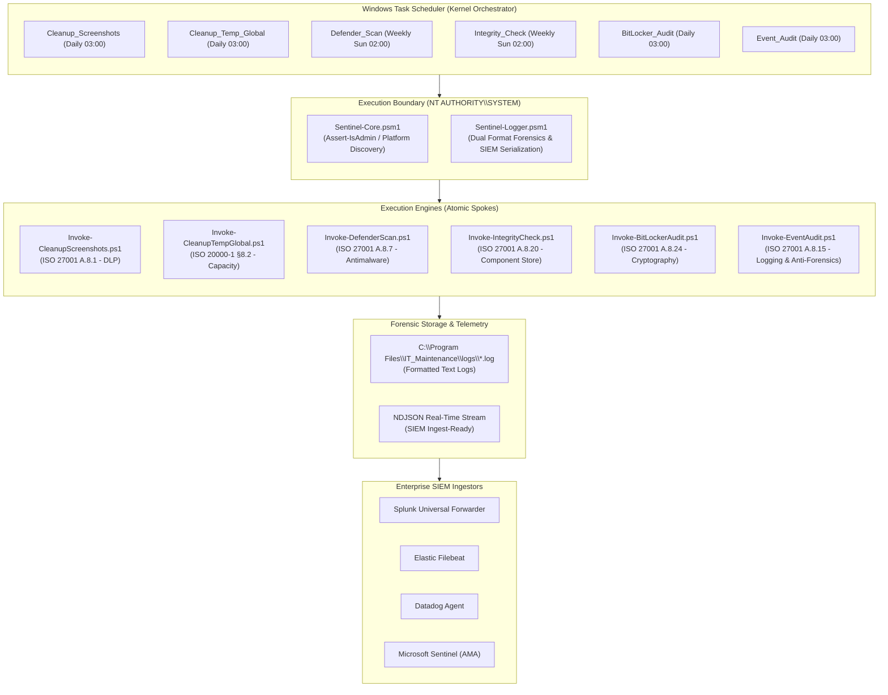

# Arquitectura del Sistema — Sentinel-IT Suite

**Marca & Distribución:** Isora Cloud Group  
**Copyright & Arquitectura:** Sandra Gabriela Puerto Torres (SGPT) ([sandrapuerto.com](https://sandrapuerto.com) · [GitHub: @sandra-puerto](https://github.com/sandra-puerto) · [LinkedIn](https://www.linkedin.com/in/sandra-puerto/))  
**Implementación Agéntica:** Google Antigravity AI Engine  
**Versión del Documento:** 2.2.0  
**Taxonomía Arquitectónica:** Hub-and-Spoke Modular, Cero Dependencias Externas  

---

## 1. Visión General del Diseño

**Sentinel-IT** fue concebido como un framework de automatización y gobierno de infraestructura Windows que elimina por completo la necesidad de agentes pesados en segundo plano (residentes en memoria RAM), gestores de paquetes externos o dependencias complejas.

El sistema opera bajo un patrón **Hub-and-Spoke**:
* **El Hub (Núcleo Compartido):** Centralizado en `src/lib/`, proporciona aserciones determinísticas de privilegios, resolución dinámica de binarios de seguridad del sistema operativo y un motor forense de registro dual (Human Text / NDJSON).
* **Los Spokes (Motores Atómicos):** Ubicados en `src/engines/`, cada script representa una rutina autosuficiente que implementa un control específico de seguridad de la información (**ISO/IEC 27001:2022**) o de gestión de servicios TI (**ISO/IEC 20000-1:2018**).

---

## 2. Diagrama de Arquitectura y Flujo de Datos



---

## 3. Modelo de Privilegios y Frontera de Seguridad

### 3.1. Contexto de Ejecución `NT AUTHORITY\SYSTEM`
Las rutinas de saneamiento de perfiles de usuario, escaneo del almacén de componentes (`WinSxS`) e inspección de BitLocker requieren acceder a espacios de almacenamiento protegidos por el kernel de Windows. Para evitar ventanas de confirmación interactivas de UAC y garantizar su ejecución en estaciones desatendidas:
1. Las tareas se registran con `Principal.UserId = "NT AUTHORITY\SYSTEM"` y `RunLevel = Highest`.
2. Todo motor invoca `Assert-IsAdmin` como primera instrucción en tiempo de ejecución. Si el token de seguridad no posee el rol de Administrador o SYSTEM, el proceso aborta inmediatamente con una excepción terminal, impidiendo cualquier ejecución accidental por usuarios estándar.

### 3.2. Modelo de Amenazas y Prevención de LPE (Local Privilege Escalation)
Dado que los scripts se ejecutan como `SYSTEM`, el directorio de instalación debe protegerse contra inyección de código:
* **Ruta de Despliegue:** `C:\Program Files\IT_Maintenance\Sentinel-IT\`
* **Herencia de ACLs:** Hereda las listas de control de acceso de `C:\Program Files`, donde solo los miembros del grupo local `BUILTIN\Administrators` y `NT AUTHORITY\SYSTEM` poseen permisos de escritura y modificación (`(W)`, `(M)`). Los usuarios estándar solo tienen derechos de lectura y ejecución (`(RX)`).

---

## 4. Diseño del Motor de Logging (Sentinel-Logger)

En lugar de depender de herramientas pesadas de terceros, `Sentinel-Logger.psm1` implementa una arquitectura de logging forense estandarizada:

```
┌────────────────────────────────────────────────────────┐
│             Write-AuditEntry Invocación                │
│    (Message, Level, Metadata: ProfileCount, ExitCode)  │
└──────────────────────────┬─────────────────────────────┘
                           │
             ¿$global:SentinelLogFormat?
              ├── "TEXT" ───► "[Timestamp] [LEVEL  ] [PID:xxxx] [SYSTEM] Message | Key=Val"
              └── "JSON" ───► {"Timestamp":"...","Level":"...","Host":"...","Metadata":{...}}
```

### Características de Ingeniería:
1. **Detección Dinámica de Configuración:** Lee `$env:SENTINEL_LOG_FORMAT` y `$env:SENTINEL_LOG_DIR` con valores por defecto seguros (`"TEXT"` y `"C:\Program Files\IT_Maintenance\logs"`), permitiendo gobierno remoto mediante GPO.
2. **Serialización Segura de Metadatos:** Utiliza bucles nativos `foreach` sobre diccionarios tipados para garantizar total compatibilidad con Windows PowerShell 5.1 y PowerShell Core 7+, previniendo problemas de enlace de parámetros.
3. **Escritura Atómica UTF-8:** Todas las entradas son agregadas en modo append con codificación UTF-8 estricta.

---

## 5. Distribución de Archivos Post-Instalación

```text
C:\Program Files\IT_Maintenance\
├── logs\
│   ├── ISO_BitLocker_Audit\
│   ├── ISO_Cleanup_Screenshots\
│   ├── ISO_Cleanup_Temp_Global\
│   ├── ISO_Defender_Scan\
│   ├── ISO_Event_Audit\
│   └── ISO_Integrity_Check\
└── Sentinel-IT\
    ├── engines\
    │   ├── Invoke-BitLockerAudit.ps1
    │   ├── Invoke-CleanupScreenshots.ps1
    │   ├── Invoke-CleanupTempGlobal.ps1
    │   ├── Invoke-DefenderScan.ps1
    │   ├── Invoke-EventAudit.ps1
    │   └── Invoke-IntegrityCheck.ps1
    └── lib\
        ├── Sentinel-Core.psm1
        └── Sentinel-Logger.psm1
```
