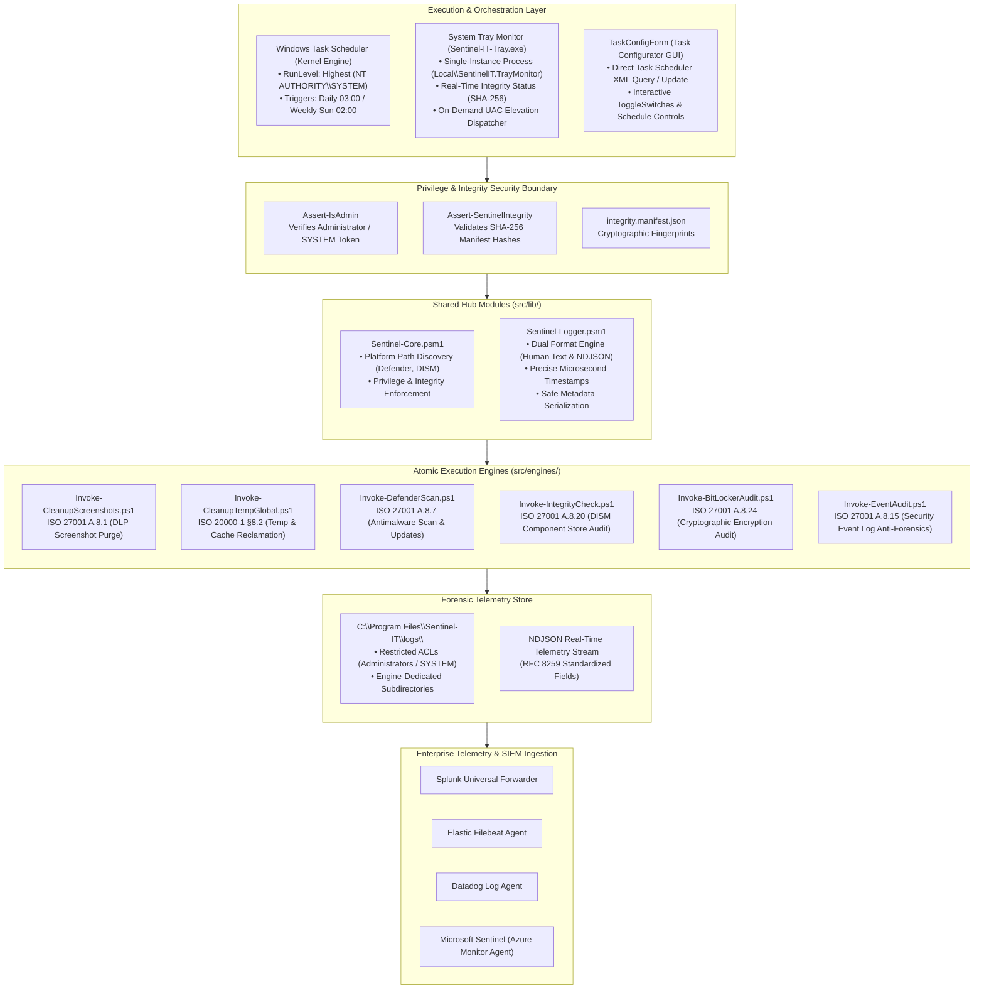
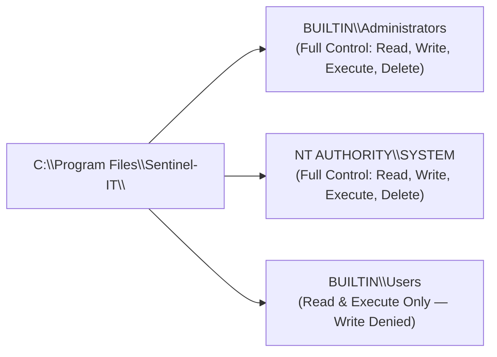
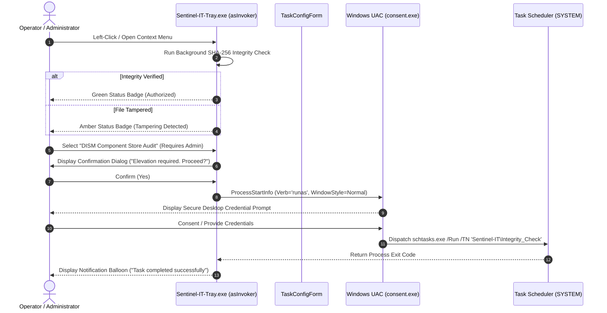
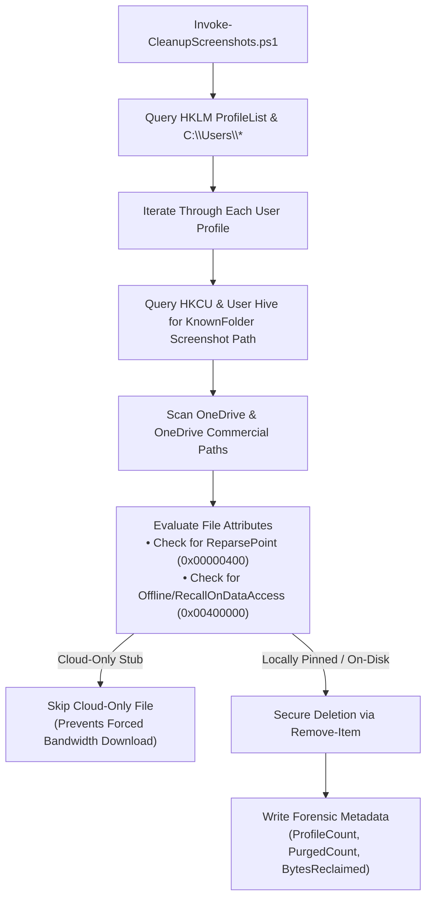

# System Architecture Specification — Sentinel-IT Suite

**Commercial Brand & Distribution:** Isora Cloud Group  
**Sole Copyright Holder & Architect:** Sandra Gabriela Puerto Torres ([sandrapuerto.com](https://sandrapuerto.com) · [GitHub: @sandra-puerto](https://github.com/sandra-puerto) · [LinkedIn](https://www.linkedin.com/in/sandra-puerto/))  
**Agentic AI Implementation:** Google Antigravity AI Engine  
**Document Version:** 2.2.0  
**Architectural Taxonomy:** Modular Hub-and-Spoke, Zero External Dependencies, Sovereign Local Execution  

---

## 1. Architectural Vision & Core Tenets

**Sentinel-IT** was engineered from inception to solve a major challenge in corporate Windows infrastructure management: the reliance on bloated, proprietary third-party endpoint agents that introduce unmonitored attack surfaces, consume significant CPU/RAM memory, and operate with opaque, vendor-locked telemetry.

The platform is designed upon four uncompromising architectural tenets:

1. **Zero External Dependencies:** Native to Windows PowerShell 5.1 and PowerShell Core 7+. Requires zero external package managers (NuGet, Chocolatey, Scoop), zero non-standard runtimes (Python, Node.js, Ruby), and zero unverified compiled DLLs.
2. **Deterministic Hub-and-Spoke Topology:** Decouples shared governance, cryptographic validation, and telemetry formatting into a central core library (`src/lib/`), while isolating operational maintenance routines into independent atomic spokes (`src/engines/`).
3. **Defense-in-Depth Privilege Separation:** High-privilege operating system tasks run under `NT AUTHORITY\SYSTEM` without interactive UAC prompts, while user-centric data operations (such as personal screenshot purges) can execute within the active user session token.
4. **Forensic Immutability & SIEM Interoperability:** Every routine generates deterministic, RFC 8259-compliant NDJSON telemetry with microsecond timestamps, operating system identity, PID, and structured metadata suitable for direct ingestion into Splunk, Elastic, Datadog, or Microsoft Sentinel.

---

## 2. Global Architecture & Data Flow



---

## 3. Privilege Model & Security Boundaries

### 3.1. `NT AUTHORITY\SYSTEM` Execution Context
System-wide hygiene operations (purging multi-user temporary files, auditing the Windows Component Store via DISM, querying BitLocker volume encryption metadata across locked volumes, and reading the Windows Security Event log) require elevated operating system privileges.

1. **Scheduled Task Identity:** Automated routines are registered in Windows Task Scheduler under `NT AUTHORITY\SYSTEM` with `RunLevel = Highest`. This enables fully unattended, background execution without interactive UAC dialogs.
2. **Explicit Privilege Assertion:** Every engine executes `Assert-IsAdmin` upon entry. If the caller does not hold the Local Administrator or SYSTEM security identifier, the script terminates immediately with a non-zero exit code, preventing unauthorized standard users from invoking administrative logic.
3. **Cryptographic Manifest Verification:** Prior to performing actions, `Assert-SentinelIntegrity` recalculates the SHA-256 hash of all libraries and engines and compares them against `integrity.manifest.json`.

### 3.2. Local Privilege Escalation (LPE) Defense
Because scripts run with `SYSTEM` privileges, the installation directory (`C:\Program Files\Sentinel-IT\`) is strictly protected against binary hijacking and script poisoning:



Standard users cannot alter script content, overwrite manifest files, or plant rogue modules to gain elevated privileges.

---

## 4. System Tray Observability & Elevation Architecture

Sentinel-IT includes a lightweight, unmanaged C# Windows Forms utility (`Sentinel-IT-Tray.exe`) that executes in the user's interactive desktop session:



### Technical Highlights of `Sentinel-IT-Tray.exe`:
* **High-DPI Awareness:** Uses `SetProcessDPIAware()` and dynamic layout scaling based on screen PPI (96 to 288 DPI), rendering crisp vector glyphs and typography on 4K displays.
* **Non-Blocking Elevation:** Starts elevated tasks using `ProcessStartInfo` with `Verb = "runas"` and `WindowStyle = ProcessWindowStyle.Normal`. PowerShell hides itself internally with `-WindowStyle Hidden`, avoiding the Windows 10/11 UAC suppression bug caused by `SW_HIDE`.
* **Asynchronous Thread Pool Waiting:** Eliminates cross-integrity `EnableRaisingEvents` handle duplication crashes (`Win32Exception: 0x32`) by awaiting process completion via `ThreadPool.QueueUserWorkItem(delegate { p.WaitForExit(); })`.
* **TaskConfigForm GUI (`TaskConfigForm.cs`):** Directly queries Windows Task Scheduler XML definitions via `schtasks.exe /Query /XML`, parsing frequencies (Daily, Weekly, Monthly), day-of-week selections, and start boundaries without external management dependencies.

---

## 5. Multi-User Discovery & Cloud Storage Protection

The screenshot purging engine (`Invoke-CleanupScreenshots.ps1`) implements intelligent multi-profile discovery:



---

## 6. Dual-Format Forensic Telemetry Engine

The logging engine (`Sentinel-Logger.psm1`) guarantees deterministic audit logging across heterogeneous environments:

1. **Human-Readable Text Format (`TEXT`):**
   ```text
   [2026-10-28 01:05:42.1284591] [SUCCESS] [PID:15024] [NT AUTHORITY\SYSTEM] VOLUME COMPLIANT: C: is fully encrypted | MountPoint=C:, ProtectionStatus=On, EncryptionPct=100
   ```
2. **RFC 8259 Standardized JSON Format (`JSON`):**
   ```json
   {
     "Timestamp": "2026-10-28 01:05:42.1284591",
     "Level": "SUCCESS",
     "Host": "DESKTOP-FIN01",
     "Identity": "NT AUTHORITY\\SYSTEM",
     "PID": 15024,
     "Message": "VOLUME COMPLIANT: C: is fully encrypted with active hardware protection.",
     "Metadata": {
       "MountPoint": "C:",
       "ProtectionStatus": "On",
       "VolumeStatus": "FullyEncrypted",
       "EncryptionPct": "100",
       "KeyProtectors": "Tpm;RecoveryPassword",
       "AuditStandard": "ISO/IEC 27001:2022 Control A.8.24"
     }
   }
   ```

Toggled transparently across all fleet endpoints via the machine-level environment variable:
```powershell
[System.Environment]::SetEnvironmentVariable("SENTINEL_LOG_FORMAT", "JSON", "Machine")
```

---

## 7. Failure Handling & Self-Healing Matrix

| Component | Failure Condition | Architectural Defense & Recovery Behavior |
| :--- | :--- | :--- |
| **`Assert-SentinelIntegrity`** | SHA-256 hash mismatch in any file | Immediate terminal exception; halts before running high-privilege code; writes forensic security event. |
| **`Invoke-DefenderScan`** | Signature update server unreachable (offline endpoint) | Network timeout caught gracefully; logs `WARN` and proceeds with cached antimalware definitions without failing. |
| **`Invoke-IntegrityCheck`** | Component Store corruption detected (DISM exit code 20) | Emits `WARN` alert to SIEM; if `-AutoRepair` is enabled, triggers `/RestoreHealth` automatically. |
| **`Invoke-BitLockerAudit`** | Unencrypted volume or protection suspended | Flags volume with `WARN` severity; records unencrypted volume status for immediate SOC alerting. |
| **`Invoke-EventAudit`** | Security Event Log cleared (Event 1102) | Emits immediate `ERROR` alert with actor identity and timestamp indicating potential anti-forensics evasion. |
| **`Sentinel-IT-Tray`** | Scheduled task not yet registered in Task Scheduler | Detects missing task and falls back seamlessly to direct elevated PowerShell script execution. |
