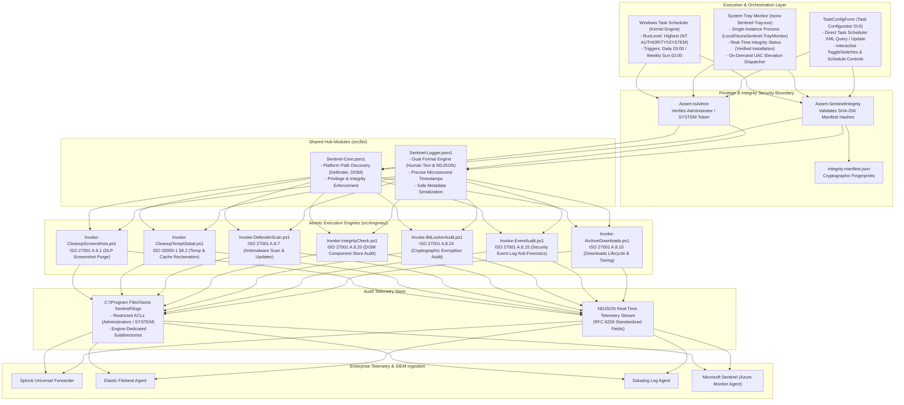
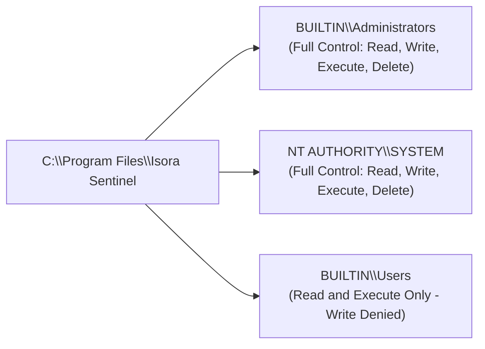
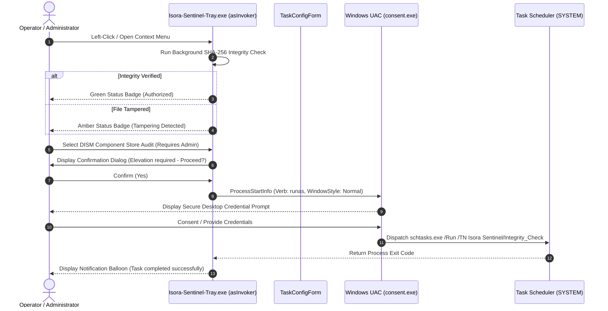
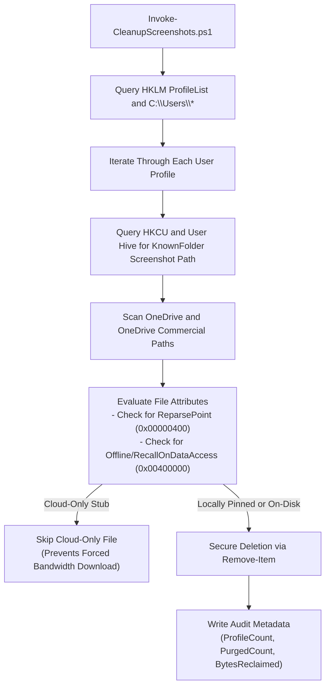
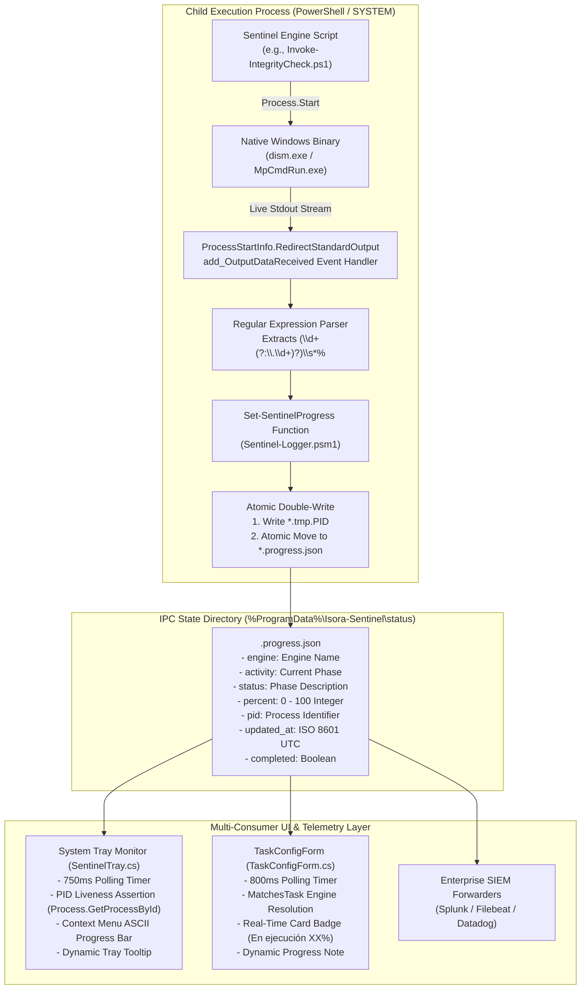

# System Architecture Specification — Isora Sentinel Suite

**Commercial Brand & Distribution:** Isora Cloud Group  
**Architect & Copyright Holder:** Sandra Gabriela Puerto Torres ([sandrapuerto.com](https://sandrapuerto.com) · [GitHub: @sandra-puerto](https://github.com/sandra-puerto) · [LinkedIn](https://www.linkedin.com/in/sandra-puerto/))  
**Document Version:** 2.4.7  
**Architectural Taxonomy:** Modular Hub-and-Spoke, Zero External Dependencies, Sovereign Local Execution  

---

## 1. Architectural Vision & Core Tenets

**Isora Sentinel** was engineered to provide lightweight, native endpoint auditing and cleanup for Microsoft Windows environments, avoiding reliance on heavy background services, opaque vendor agents, or unverified third-party runtimes.

The platform is designed upon four uncompromising architectural tenets:

1. **Zero External Dependencies:** Native to Windows PowerShell 5.1 and PowerShell Core 7+. Requires zero external package managers (NuGet, Chocolatey, Scoop), zero non-standard runtimes (Python, Node.js, Ruby), and zero unverified compiled DLLs.
2. **Deterministic Hub-and-Spoke Topology:** Decouples shared governance, cryptographic validation, and telemetry formatting into a central core library (`src/lib/`), while isolating operational maintenance routines into independent atomic spokes (`src/engines/`).
3. **Defense-in-Depth Privilege Separation:** High-privilege operating system tasks run under `NT AUTHORITY\SYSTEM` without interactive UAC prompts, while user-centric data operations (such as personal screenshot purges) can execute within the active user session token.
4. **Structured Telemetry & SIEM Interoperability:** Every routine generates deterministic, RFC 8259-compliant NDJSON telemetry with microsecond timestamps, operating system identity, PID, and structured metadata suitable for direct ingestion into Splunk, Elastic, Datadog, or Microsoft Sentinel.

---

## 2. Global Architecture & Data Flow



---

## 3. Privilege Model & Security Boundaries

### 3.1. `NT AUTHORITY\SYSTEM` Execution Context
System-wide maintenance and hardening operations (purging multi-user temporary files, auditing the Windows Component Store via DISM, querying BitLocker volume encryption metadata across locked volumes, and reading the Windows Security Event log) require elevated operating system privileges.

1. **Scheduled Task Identity:** Automated routines are registered in Windows Task Scheduler under `NT AUTHORITY\SYSTEM` with `RunLevel = Highest`. This enables fully unattended, background execution without interactive UAC dialogs.
2. **Explicit Privilege Assertion:** Every engine executes `Assert-IsAdmin` upon entry. If the caller does not hold the Local Administrator or SYSTEM security identifier, the script terminates immediately with a non-zero exit code, preventing unauthorized standard users from invoking administrative logic.
3. **Tamper-Evident Integrity Check:** Prior to performing actions, `Assert-SentinelIntegrity` recalculates the SHA-256 hash of all libraries and engines and compares them against `integrity.manifest.json`. Under `NT AUTHORITY\SYSTEM` or production paths, any mismatch triggers an immediate terminating error (`throw`) to halt execution (Fail-Closed).
   > **Limitation Note:** The manifest file is not cryptographically signed. Therefore, a user with administrative rights can alter both operational files and the manifest. This check is designed to detect accidental file corruption or unsophisticated modification only.

### 3.2. Local Privilege Escalation (LPE) Defense
Because scripts run with `SYSTEM` privileges, the installation directory (`C:\Program Files\Isora-Sentinel\`) is strictly protected against binary hijacking and script poisoning:



Standard users cannot alter script content, overwrite manifest files, or plant rogue modules to gain elevated privileges.

---

## 4. System Tray Observability & Elevation Architecture

Isora Sentinel includes a lightweight, unmanaged C# Windows Forms utility (`Isora-Sentinel-Tray.exe`) that executes in the user's interactive desktop session:



### Technical Highlights of `Isora-Sentinel-Tray.exe`:
* **High-DPI Awareness:** Uses `SetProcessDPIAware()` and dynamic layout scaling based on screen PPI (96 to 288 DPI), rendering crisp vector glyphs and typography on 4K displays.
* **Non-Blocking Elevation:** Starts elevated tasks using `ProcessStartInfo` with `Verb = "runas"`, avoiding the Windows 10/11 UAC suppression bug caused by `SW_HIDE` on elevated parent processes. Background non-elevated executions use `CreateNoWindow = true` cleanly without shell window flicker.
* **Asynchronous Thread Pool Waiting:** Eliminates cross-integrity `EnableRaisingEvents` handle duplication crashes (`Win32Exception: 0x32`) by awaiting process completion via `ThreadPool.QueueUserWorkItem(delegate { p.WaitForExit(); })`.
* **TaskConfigForm GUI (`TaskConfigForm.cs`):** Directly queries Windows Task Scheduler XML definitions via `schtasks.exe /Query /XML`, parsing frequencies (Daily, Weekly, Monthly), day-of-week selections, and start boundaries without external management dependencies.

---

## 5. Multi-User Discovery & Cloud Storage Protection

The screenshot purging engine (`Invoke-CleanupScreenshots.ps1`) implements intelligent multi-profile discovery:



---

## 6. Dual-Format Audit Telemetry Engine

The logging engine (`Sentinel-Logger.psm1`) is designed to provide deterministic audit logging across heterogeneous environments:

1. **Human-Readable Text Format (`TEXT`):**
   ```text
   [2026-10-28 01:05:42.1284591] [SUCCESS] [PID:15024] [NT AUTHORITY\SYSTEM] VOLUME COMPLIANT: C: is fully encrypted | MountPoint=C:, ProtectionStatus=On, EncryptionPct=100
   ```
2. **RFC 8259 Standardized JSON Format (`JSON`):**
   ```json
   {
     "Timestamp": "2026-10-28 01:05:42.1284591",
     "Level": "SUCCESS",
     "Host": "DESKTOP-FIN01",
     "Identity": "NT AUTHORITY\\SYSTEM",
     "PID": 15024,
     "Message": "VOLUME COMPLIANT: C: is fully encrypted with active hardware protection.",
     "Metadata": {
       "MountPoint": "C:",
       "ProtectionStatus": "On",
       "VolumeStatus": "FullyEncrypted",
       "EncryptionPct": "100",
       "KeyProtectors": "Tpm;RecoveryPassword",
       "AuditStandard": "ISO/IEC 27001:2022 Control A.8.24"
     }
   }
   ```

Toggled transparently across all fleet endpoints via the machine-level environment variable:
```powershell
[System.Environment]::SetEnvironmentVariable("SENTINEL_LOG_FORMAT", "JSON", "Machine")
```

---

## 7. Failure Handling & Self-Healing Matrix

| Component | Failure Condition | Architectural Defense & Recovery Behavior |
| :--- | :--- | :--- |
| **`Assert-SentinelIntegrity`** | SHA-256 hash mismatch in any file | Immediate terminal exception; halts before running high-privilege code; writes forensic security event. |
| **`Invoke-DefenderScan`** | Signature update server unreachable (offline endpoint) | Network timeout caught gracefully; logs `WARN` and proceeds with cached antimalware definitions without failing. |
| **`Invoke-IntegrityCheck`** | Component Store corruption detected (DISM exit code 20) | Emits `WARN` alert to SIEM; if `-AutoRepair` is enabled, triggers `/RestoreHealth` automatically. |
| **`Invoke-BitLockerAudit`** | Unencrypted volume or protection suspended | Flags volume with `WARN` severity; records unencrypted volume status for immediate SOC alerting. |
| **`Invoke-EventAudit`** | Security Event Log cleared (Event 1102) | Emits immediate `ERROR` alert with actor identity and timestamp indicating potential anti-forensics evasion. |
| **`Isora Sentinel-Tray`** | Scheduled task not yet registered in Task Scheduler | Detects missing task and falls back automatically to direct elevated PowerShell script execution. |


---

## 8. Process Telemetry & Real-Time Progress Extraction Architecture

### 8.1. Design Rationale & IPC Principles
In enterprise endpoint environments, maintenance routines often execute as background tasks under `NT AUTHORITY\SYSTEM` or within elevated user contexts. Providing visibility into long-running tasks (such as DISM component store checks, complete antimalware sweeps, or mass temporary cache purges) requires a robust, non-blocking telemetry mechanism.

Traditional progress bars in GUI applications either block the UI thread waiting for external binaries or rely on fragile IPC primitives (such as named pipes or shared memory) that face access control hurdles across Windows Integrity Levels (Medium vs. High vs. SYSTEM). 

Isora Sentinel implements an **asynchronous, event-driven stdout stream extraction and atomic filesystem IPC architecture** that is fully decoupled, safe across integrity boundaries, and zero-dependency.



---

### 8.2. Child Process Asynchronous Stream Interception & Regex Extraction

For engines that wrap native Microsoft Windows command-line utilities (`dism.exe` and `MpCmdRun.exe`), standard synchronous reading (`Process.StandardOutput.ReadToEnd()`) is explicitly avoided because it buffers entire streams and deadlocks when buffer thresholds are saturated. Instead, Isora Sentinel uses asynchronous event-driven streaming:

1. **Stream Redirection Setup:**
   ```powershell
   $psi = New-Object System.Diagnostics.ProcessStartInfo
   $psi.FileName = $dismPath
   $psi.Arguments = "/Online /Cleanup-Image /ScanHealth"
   $psi.RedirectStandardOutput = $true
   $psi.RedirectStandardError = $true
   $psi.UseShellExecute = $false
   $psi.CreateNoWindow = $true

   $proc = New-Object System.Diagnostics.Process
   $proc.StartInfo = $psi
   ```

2. **Event-Driven Regex Matching:**
   A script block event handler is attached to `.add_OutputDataReceived`. As native child processes output buffer chunks, the regex matches percentage expressions and scales them into an overall progress range:
   ```powershell
   $proc.add_OutputDataReceived({
       param($sender, $e)
       if ($e.Data) {
           $line = $e.Data
           if ($line -match '(\d+(?:\.\d+)?)\s*%') {
               $rawPct = [double]$matches[1]
               # Normalize DISM scan phase (0% - 100%) to suite phase (15% - 95%)
               $clamped = [int][math]::Min(95, [math]::Max(15, (15 + ($rawPct * 0.8))))
               Set-SentinelProgress -Activity "Comprobación de Windows (DISM)" `
                                    -Percent $clamped `
                                    -Status "DISM ScanHealth: $([math]::Round($rawPct, 1))% completado"
           }
       }
   })
   $proc.Start()
   $proc.BeginOutputReadLine()
   $proc.BeginErrorReadLine()
   $proc.WaitForExit()
   ```

3. **Multi-Phase State Tracking Across All 7 Engines:**
   - **`Invoke-IntegrityCheck`:** Phase 1 (0%-15%): Initialization & tamper verification; Phase 2 (15%-95%): Asynchronous DISM ScanHealth parsing; Phase 3 (95%-100%): Exit code analysis and `/RestoreHealth` remediation dispatch.
   - **`Invoke-DefenderScan`:** Phase 1 (0%-15%): Integrity verification; Phase 2 (15%-30%): Dynamic signature definition update (`-SignatureUpdate`); Phase 3 (30%-95%): Asynchronous scan stream interception (`MpCmdRun.exe -Scan`); Phase 4 (95%-100%): Forensic logging and exit code verification.
   - **`Invoke-CleanupScreenshots`:** Phase 1 (0%-20%): Active profile discovery across `HKLM ProfileList` and `C:\Users`; Phase 2 (20%-90%): Granular per-profile iteration calculating scanned vs. purged vector ratios; Phase 3 (90%-100%): Audit finalization.
   - **`Invoke-CleanupTempGlobal`:** Phase 1 (0%-20%): System Temp; Phase 2 (20%-40%): Windows Update `SoftwareDistribution` and WER error report queues; Phase 3 (40%-90%): Granular per-profile AppData Temp and CrashDump sanitization; Phase 4 (90%-100%): Capacity reclamation summary.
   - **`Invoke-ArchiveDownloads`:** Phase 1 (0%-20%): Multi-user registry discovery; Phase 2 (20%-40%): File candidate filtering and age threshold calculations; Phase 3 (40%-90%): Item-by-item atomic relocation with collision detection; Phase 4 (90%-100%): Policy notice generation (`LEAME_POLITICA_TI.txt`).
   - **`Invoke-BitLockerAudit`:** Phase 1 (0%-25%): Volume and protector detection; Phase 2 (25%-90%): Per-volume cryptographic status verification (evaluating `ProtectionStatus`, `VolumeStatus`, and TPM/PIN protector bindings); Phase 3 (90%-100%): Compliance posture reporting.
   - **`Invoke-EventAudit`:** Phase 1 (0%-30%): Anti-forensics Event 1102 & 104 log clearance checks; Phase 2 (30%-60%): Event 4625 brute-force spike monitoring; Phase 3 (60%-90%): Event 4720/4726 account provisioning auditing; Phase 4 (90%-100%): Security event threshold summation.

---

### 8.3. Cross-Boundary State Synchronization Protocol (Atomic JSON IPC)

Progress state is exchanged via structured status files located in the globally accessible directory `%ProgramData%\Isora-Sentinel\status\`:

```json
{
  "engine": "ISO_Integrity_Check",
  "activity": "Comprobación de Windows (DISM)",
  "status": "DISM /ScanHealth: 40.0% completado",
  "percent": 47,
  "pid": 9840,
  "updated_at": "2026-11-01T06:00:15.120Z",
  "completed": false
}
```

#### Collision Prevention & Atomic Writes
To prevent partial file reads by UI processes running concurrently:
1. The engine writes status to a process-unique temporary file: `<statusFile>.tmp.<PID>`.
2. The file is flushed to disk with UTF-8 encoding (no BOM).
3. An atomic filesystem move (`Move-Item -Force`) replaces the destination `<engine>.progress.json`.
4. Reading processes open the file with `FileShare.ReadWrite | FileShare.Delete` tolerance.

---

### 8.4. Process Lifecycle Verification & Anti-Zombie Protection

In distributed endpoint management, processes can terminate unexpectedly (e.g., system shutdown, task scheduler timeouts, out-of-memory kills). A static status file would risk displaying a permanently "running" task.

To eliminate ghost states, the `TaskProgressInfo.IsActive()` method performs a two-tier validation:
1. **Operating System PID Verification:**
   ```csharp
   if (Pid > 0)
   {
       try
       {
           Process p = Process.GetProcessById(Pid);
           if (p.HasExited) return false;
       }
       catch
       {
           return false; // Process does not exist
       }
   }
   ```
2. **Heartbeat Staleness Assertion:**
   If `DateTime.UtcNow - UpdatedAt > 45 seconds`, the task is considered expired.
3. **Automatic Stale Purge:**
   When `IsActive()` evaluates to `false` or `completed == true`, the status consumer immediately purges the orphan status file from disk.

---

### 8.5. UI Representation & User Experience

State tracking is surfaced across multiple intuitive layers:
- **Tray Icon Tooltip:** Dynamically updates to reflect the active routine: `Isora Sentinel: Comprobación de Windows (DISM) (47%)`.
- **Tray Context Menu:** Displays a dedicated high-visibility live item with an ASCII progress bar:
  ```text
  ⚡ Comprobación de Windows (DISM) [47%]
    [██████░░░░░░] 47%  DISM /ScanHealth: 40.0% completado
  ```
- **Task Configuration Window (`TaskConfigForm`):**
  Each routine card dynamically updates its status badge from `Activa` or `No programada` to `⚡ En ejecución (47%)` with an amber highlight, while the descriptive note displays live phase details and progress bars.

---

### 8.6. Process Tree Termination & Elevated Cancellation Subsystem

When maintenance routines run under `NT AUTHORITY\SYSTEM` (e.g., triggered by Windows Task Scheduler) or in high-integrity administrator sessions, processes operating at lower integrity levels (such as `Isora-Sentinel-Tray.exe` running within a standard user desktop session) cannot terminate them directly using Win32 `TerminateProcess` or .NET `Process.Kill()`, as Windows returns `ERROR_ACCESS_DENIED` (Win32 Error 5).

To enable operators to cancel long-running or resource-intensive tasks on demand without compromising security:

1. **Explicit Confirmation & Privilege Elevation:**
   Clicking the cancel button (in either the Tray menu or `TaskConfigForm`) displays a warning dialog detailing the task name and PID. Upon confirmation, the application requests Windows UAC elevation (`runas` verb).

2. **Recursive Process Tree Kill (`taskkill /PID <PID> /T /F`):**
   PowerShell processes often invoke secondary binaries (`dism.exe`, `MpCmdRun.exe`). A simple PID kill would terminate PowerShell while leaving the child engine running in the background. The elevated cancellation dispatcher executes:
   ```cmd
   taskkill.exe /PID <pid> /T /F
   ```
   * `/T`: Recursively navigates and terminates the entire process subtree.
   * `/F`: Forcefully halts processes without waiting for graceful message handling.

3. **Atomic State Invalidation:**
   Simultaneously, the elevated dispatcher purges `%ProgramData%\Isora-Sentinel\status\<engine>.progress.json`. On the subsequent polling tick (800 ms), `TaskConfigForm` and `SentinelTray` verify process non-existence and immediately reset their visual badges to idle.
