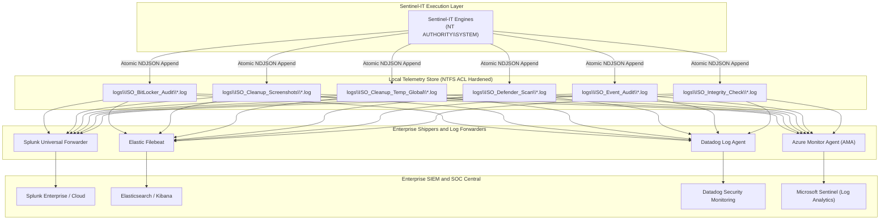

# Enterprise SIEM Ingestion & Security Operations Guide — Sentinel-IT Suite

**Commercial Brand & Distribution:** Isora Cloud Group  
**Sole Copyright Holder & Architect:** Sandra Gabriela Puerto Torres ([sandrapuerto.com](https://sandrapuerto.com) · [GitHub: @sandra-puerto](https://github.com/sandra-puerto) · [LinkedIn](https://www.linkedin.com/in/sandra-puerto/))  
**Compliance Standard:** ISO/IEC 27001:2022 Control A.8.15 (Logging and Monitoring)  
**Telemetry Format:** UTF-8 JSON (RFC 8259) delimited by newlines (NDJSON)  
**Supported Platforms:** Splunk Enterprise / Cloud, Elastic Stack (ELK), Datadog Log Management, Microsoft Sentinel (Azure Monitor)  

---

## 1. Zero-Dependency Ingestion Architecture

Sentinel-IT avoids the pitfalls of running background daemon sockets or pushing TLS traffic directly inside PowerShell scripts. Instead, it emits structured, atomic forensic logs directly to the local filesystem at `C:\Program Files\Sentinel-IT\logs\<EngineName>\*.log`.

Industry-standard enterprise log forwarders (Splunk Universal Forwarder, Elastic Filebeat, Datadog Agent, Azure Monitor Agent) harvest these files in real time, handling local disk buffers, bandwidth throttling, compression, and TLS transmission to the central SIEM repository:



---

## 2. Enabling Machine-Wide NDJSON Telemetry

To configure Sentinel-IT to output standardized NDJSON logs across all scheduled tasks and manual runs:

```powershell
# Set machine-wide environment variable (persistent across reboots):
[System.Environment]::SetEnvironmentVariable("SENTINEL_LOG_FORMAT", "JSON", "Machine")

# Optional: Override forensic log root directory:
# [System.Environment]::SetEnvironmentVariable("SENTINEL_LOG_DIR", "D:\EnterpriseLogs\Sentinel-IT", "Machine")
```

---

## 3. Standardized Event Schema (RFC 8259)

Each log record is emitted as a single-line JSON document:

```json
{
  "Timestamp": "2026-10-28 01:05:42.1284591",
  "Level": "SUCCESS",
  "Host": "SRV-LON-APP01",
  "Identity": "NT AUTHORITY\\SYSTEM",
  "PID": 15024,
  "Message": "VOLUME COMPLIANT: Volume C: is fully encrypted with active hardware protection.",
  "Metadata": {
    "MountPoint": "C:",
    "ProtectionStatus": "On",
    "VolumeStatus": "FullyEncrypted",
    "EncryptionPct": "100",
    "KeyProtectors": "Tpm;RecoveryPassword",
    "AuditStandard": "ISO/IEC 27001:2022 Control A.8.24"
  }
}
```

### Schema Field Definitions:
| Field | Type | Description |
| :--- | :--- | :--- |
| `Timestamp` | String | ISO-like microsecond precision timestamp (`yyyy-MM-dd HH:mm:ss.fffffff`). |
| `Level` | String | Severity level: `INFO`, `SUCCESS`, `WARN`, `ERROR`. |
| `Host` | String | NetBIOS / DNS hostname of the endpoint. |
| `Identity` | String | Security token identity (`NT AUTHORITY\SYSTEM` or `DOMAIN\User`). |
| `PID` | Integer | Process ID of the executing PowerShell instance. |
| `Message` | String | Human-readable audit narrative. |
| `Metadata` | Object | Control-specific key-value telemetry pairs. |

---

## 4. Forwarder Configuration Snippets

### 4.1. Splunk Universal Forwarder
Add to `%SPLUNK_HOME%\etc\system\local\inputs.conf`:

```ini
[monitor://C:\Program Files\Sentinel-IT\logs\...\*.log]
disabled = false
index = endpoint_compliance
sourcetype = sentinel:it:json
multiline_event_extra_regex = false
```

Add to `%SPLUNK_HOME%\etc\system\local\props.conf`:

```ini
[sentinel:it:json]
SHOULD_LINEMERGE = false
LINE_BREAKER = ([\r\n]+)
TIME_PREFIX = \"Timestamp\":\s*\"
TIME_FORMAT = %Y-%m-%d %H:%M:%S.%7N
KV_MODE = json
AUTO_KV_JSON = true
```

#### Splunk Detection Rules (SPL):
```spl
# Alert 1: Security Event Log Cleared (Anti-Forensics / T1070)
index=endpoint_compliance sourcetype="sentinel:it:json" Level="ERROR" Message="*Audit Log Cleared*"
| table Timestamp, Host, Identity, Message, Metadata.EventID

# Alert 2: BitLocker Encryption Dropped Below 100%
index=endpoint_compliance sourcetype="sentinel:it:json" Metadata.AuditStandard="*A.8.24*" Metadata.ProtectionStatus!="On"
| table Timestamp, Host, Metadata.MountPoint, Metadata.ProtectionStatus, Metadata.EncryptionPct
```

---

### 4.2. Elastic Filebeat
Add to `C:\Program Files\Filebeat\filebeat.yml`:

```yaml
filebeat.inputs:
- type: log
  enabled: true
  paths:
    - 'C:\Program Files\Sentinel-IT\logs\*\*.log'
  json.keys_under_root: true
  json.overwrite_keys: true
  json.add_error_key: true
  fields:
    application: sentinel-it
    compliance: iso27001
  fields_under_root: true

processors:
  - timestamp:
      field: Timestamp
      layouts:
        - '2006-01-02 15:04:05.9999999'
```

#### Elastic Kibana Query (KQL):
```kql
application: "sentinel-it" and Level: ("WARN" or "ERROR")
```

---

### 4.3. Datadog Log Agent
Add to `C:\ProgramData\Datadog\conf.d\sentinel_it.d\conf.yaml`:

```yaml
logs:
  - type: file
    path: "C:\\Program Files\\Sentinel-IT\\logs\\*\\*.log"
    service: "sentinel-it"
    source: "powershell"
    sourcecategory: "endpoint_compliance"
    tags:
      - "compliance:iso27001"
      - "env:production"
```

---

### 4.4. Microsoft Sentinel (Azure Monitor Agent)
Create a Data Collection Rule (DCR) targeting custom text logs:
* **File Pattern:** `C:\Program Files\Sentinel-IT\logs\*\*.log`
* **Custom Table:** `SentinelIT_CL`

#### Microsoft Sentinel Detection Rule (KQL):
```kql
SentinelIT_CL
| where TimeGenerated >= ago(24h)
| where Level_s == "ERROR" or (Level_s == "WARN" and Message_s has "BRUTE-FORCE")
| extend EventID = tostring(parse_json(Metadata_s).EventID)
| extend Anomalies = toint(parse_json(Metadata_s).AnomaliesDetected)
| project TimeGenerated, Host_s, Identity_s, Level_s, Message_s, EventID, Anomalies
| order by TimeGenerated desc
```
